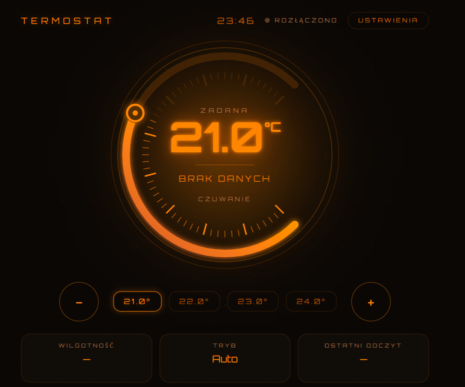
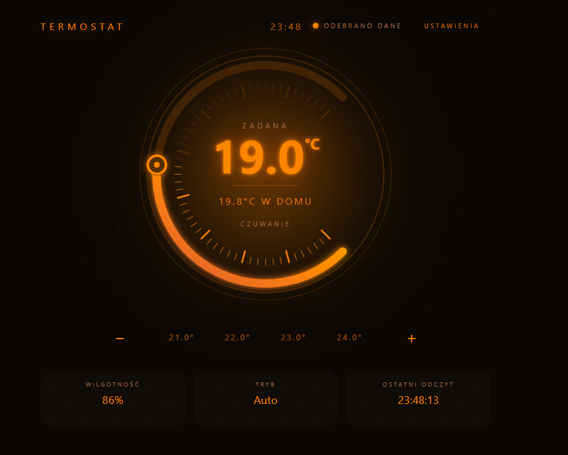

# L2NR UI
### Turn a Lovable interface into a Node-RED Dashboard 2 widget

**L2NR UI** packages a selected React component from a Lovable project
as an installable Node-RED Dashboard 2 widget. Bring your custom interface
into Node-RED and exchange data and commands through Node-RED messages.

<table>
  <tr>
    <th width="50%">Before conversion</th>
    <th width="50%">After conversion — live data</th>
  </tr>
  <tr>
    <td></td>
    <td></td>
  </tr>
  <tr>
    <td>The original application interface.</td>
    <td>The Node-RED Dashboard 2 widget receiving live controller data.</td>
  </tr>
</table>

## What does the converter do?

- Inspects the project and the selected React component.
- Reads the widget configuration from `l2nr-ui.manifest.json`.
- Generates a Dashboard 2 node with a bridge between the React interface and Node-RED messages.
- Builds the frontend and creates an installable `.tgz` package through GitHub Actions.

The component must implement the contract described below. The converter does
not automatically migrate arbitrary application logic, routing, or service
connections. Data handling, settings, and user interactions must be implemented
in the component.

## Example: Radiant Dial thermostat

[Radiant Dial](https://github.com/DariuszPiskorowski/radiant-dial) is the first
verified integration. The standalone application and the Node-RED widget share
the same panel and settings components.

| Direction | Topic | Contents |
| --- | --- | --- |
| Controller → widget | `Heating/Control/state` | Controller state, sensor readings, setpoint, AI correction, and mode |
| Widget → controller | `Heating/Control/set` | A user command in `msg.payload` |

In the widget version, **external MQTT In and MQTT Out nodes handle the MQTT connection**.
The thermostat does not need its own MQTT client or broker credentials.
Topics can be changed in its Settings panel. Changing the input topic in the UI
does not change the external MQTT In node's subscription. MQTT Out should use
`msg.topic`.

Package version **0.5.3**:

- Accepts state as an object or JSON text and filters the input topic.
- Displays `effective_setpoint`: the target temperature after AI correction.
- Adjusts the base `setpoint` using ±0.5°C buttons.
- Does not emit a command simply because an incoming state message was received.
- Stores topic settings separately for each widget in the current browser.

The integration has been tested with **Node-RED 5.0.7 and Dashboard 1.33.0**,
both directly and inside a 650 px iframe. The AI correction display fix has
also been confirmed on the user's Raspberry Pi.

## Component contract

The wrapper passes these properties to the component:

| Property | Purpose |
| --- | --- |
| `message` | The Node-RED message, including `topic` and `payload` |
| `payload` | Input data |
| `inputTopic`, `outputTopic` | Default topics from the manifest |
| `nodeId` | Widget identifier |
| `storageKey` | Storage key for this widget's settings |
| `onChange` | Callback for sending a command from the interface |

Example command:

```tsx
onChange(
  { setpoint: 21.5, mode: "normal" },
  { topic: "Heating/Control/set" }
);
```

The node outputs:

```json
{
  "topic": "Heating/Control/set",
  "payload": {
    "setpoint": 21.5,
    "mode": "normal"
  }
}
```

Omitting the second argument uses `output.topic` from the manifest.
The bridge preserves the topic through Dashboard's event handler.
Input topic filtering and the settings panel are the component's responsibility.

## Building with GitHub Actions

Use the converter action in an application repository containing the manifest
and a component that implements the contract:

```yaml
- uses: actions/checkout@v7
- name: Convert UI to a Dashboard 2 widget
  id: convert
  uses: DariuszPiskorowski/l2nr-ui@main
  with:
    command: build
    source: .
    output: .l2nr-output
```

The generated archive path is available as `steps.convert.outputs.package`.
For controlled releases, pin the action to a specific commit.

Radiant Dial's
[`l2nr-ui.yml` workflow](https://github.com/DariuszPiskorowski/radiant-dial/blob/main/.github/workflows/l2nr-ui.yml)
also extracts the package, runs it in a test Node-RED instance, and verifies
the widget's actual output in Chromium before uploading the artifact.

## Developing the converter

Requires Node.js 24 or later.

```bash
npm ci
npm run check
npm test
npm run build
```

Editing the source code does not update an installed widget.
After making changes, build the package, install it in Node-RED,
restart the service, and refresh the interface.
